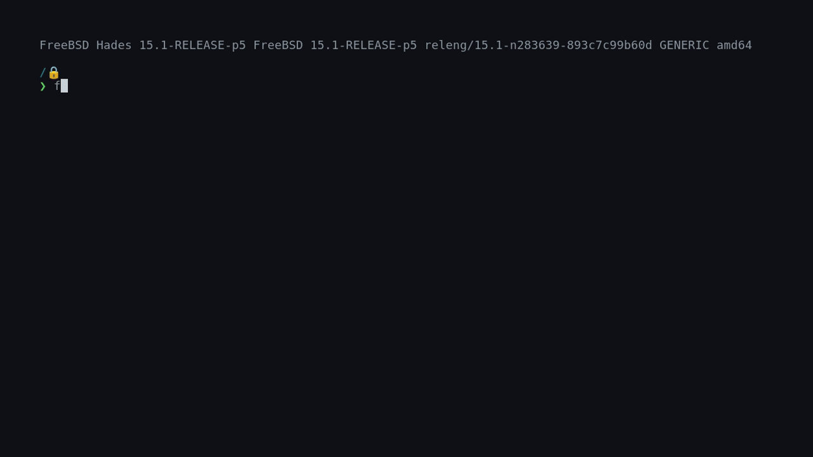

<div align="center">
  

  <h1>Flatpkg</h1>

  <p>Flatpak for BSD.</p>

<a href="https://github.com/Poiesys/flatpkg/stargazers"></a>
<a href="https://github.com/Poiesys/flatpkg/blob/master/LICENSE"></a>

</div>



Run **[Flatpak](https://github.com/flatpak/flatpak) Linux applications** on FreeBSD, end to end: install them
from Flatpak remotes, and run them sandboxed inside a per-launch
`jail(8)` built from the same primitives Flatpak's own launcher builds
its bubblewrap sandbox from, but native to FreeBSD.

[flatpkg does **not** run FreeBSD applications](https://news.ycombinator.com/item?id=30385924), and it does not
reimplement OSTree. For distribution it drives the **real `ostree`** (see ports folder).

> But why does it have a system daemon? Upstream flatpak doesn't have such a thing!

To the best of my knowledge, we need root for jails.

> I can't hear audio!

You'll probably need to set up pipewire/pulseaudio on your FreeBSD box, as that's what Linux apps use.

> Does this have any behaviour changes from upstream flatpak i should be aware of?

Due to personal preference, this implementation makes use of a worldfile, and the whole mechanisms of dependency resolution are very inspired by [Alpine Package Keeper](https://gitlab.alpinelinux.org/alpine/apk-tools). That is, every install/uninstall operation adds/removes the application from the "apps wanted by the user" list, then it checks what packages are needed for that list and installs/removes packages to match.
Every package change - install, uninstall, update or upgrade - calculates the delta, shows a table of changes and asks for confirmation.
That makes 'remove --unused' not needed and you won't accidentally end up with 30 runtimes you don't need anymore.
The world file is client state, not store metadata: flatpkg keeps its own under `clients/flatpkg/world`, and another client can keep different state (or none) in its own directory.

> How does this even work? Do i need to have the linuxulator set up in /compat/linux?

*On the surface*, the way FreeBSD's linuxulator and Flatpak work are pretty similar in some regards, and that is where the whole idea came from.
Both set up a custom linux userland apps expect, and run linux application on top of them. That is to say, you *don't* need /compat/linux set up, strictly speaking: because **we run the same userland Flatpak apps expect** in a linux jail, completely separate from whatever /compat/linux may or may not contain.

## Installing from the ports tree

```sh
    make dist                       # package this checkout for the port
    cd ports/sysutils/flatpkg
    make install
```

## Setup

- Install flatpkg, either via the port or via the makefile
- Enable the flatpkg daemon via `service flatpkgd enable`, start it via `service flatpkgd start`
> - If you want to use flathub, use this command to add the repo: ```flatpak remote-add --if-not-exists flathub https://dl.flathub.org/repo/flathub.flatpakrepo```

You can use either flatpak or flatpkg as a command name.

## AI disclaimer and usage policy

I, like many others, *don't* like AI that much. However, we can't deny that it *can* be useful. At times.
Now, writing such a massive project using only AI would be the dumbest thing i've heard all year, and that says something.
What i use it for is to help with documentation, commit messages (i have a script that takes the git diff and gives it to a local gemma4 to give me some commit messages i could use), and writing the tests (which is stupid and i fully acknowledge).
Also, as I'm not as experienced with C as I am with other languages, I often use a local model to translate some code from Haskell or Rust, which I then review.

> But then why write the project in C in the first place?

I feel like that's what most BSD people want as it's **THE** UNIX programming language, it interfaces better with the system, it's properly bootstrappable and it's what people are used to, in this space.

If the comments look sloppy or verbose at times, it's because of that. **If the code works, it's *precisely* because I didn't rely on AI for it.** If the code doesn't work, it's because i can write awful code all on my own !!! :> (look ma, no claude)

You are free to use whatever tools you want in your contributions, i mostly don't care *as long as* the code being written is maintainable and you can understand it, [**and it's a tool and not a replacement for your own reasoning.**](https://arxiv.org/abs/2502.12447)

My goal is to end up with no AI-generated code (so fully replacing the current tests with more robust ones, I think using AI to transpile between languages isn't exactly "AI-generated"), but i'm just a dude working on this project on my free time, and it took me long enough to get the code to a place i felt comfortable enough sharing, so excuse my occasional lazyness. 

If you don't like this policy, feel free to open an issue and let the people decide, we live in a democracy.

## Watch later
I didn't read any of the code of these other projects, BUT i respect trying to tackle the same issue.
If you don't like my implementation for whatever reason, here are some projects i found that might suit you best, although i haven't tried them:

- [flatpak-freebsd](https://github.com/definitly486/flatpak-freebsd/tree/main): a python implementation that downloads the app and runtime, and allows you to run it. This doesn't seem to be using any kind of sandboxing (jails or whatever) so a daemon isn't needed.
- [flatvodka](https://github.com/Gamer100Dev/flatvodka): A rust implementation that seems to achieve a lot of what we do. Uses ubuntu for their ostree binary rather than compiling it natively, and seems to offer the ability to inject libraries into the jail for better compatibility.

## License
This project is under the terms of the [BSD 3-Clause License](LICENSE)

# Disclaimer
`flatpkg` is an independent project and is not affiliated with or endorsed by FreeBSD, the Flatpak project, Flathub, or their respective maintainers.
